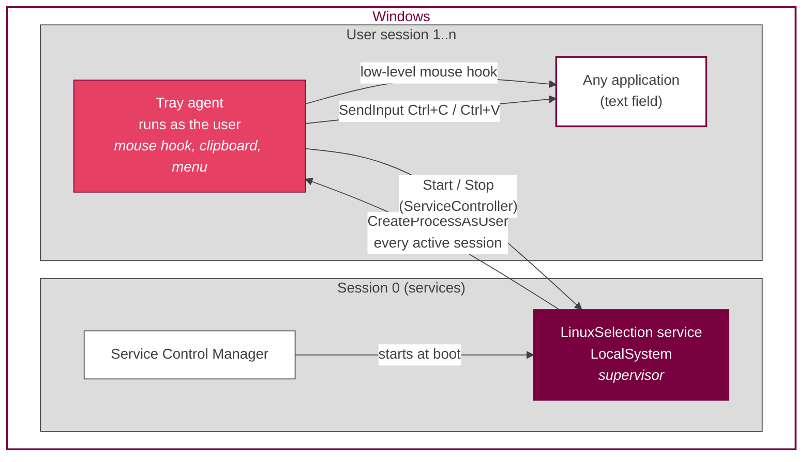
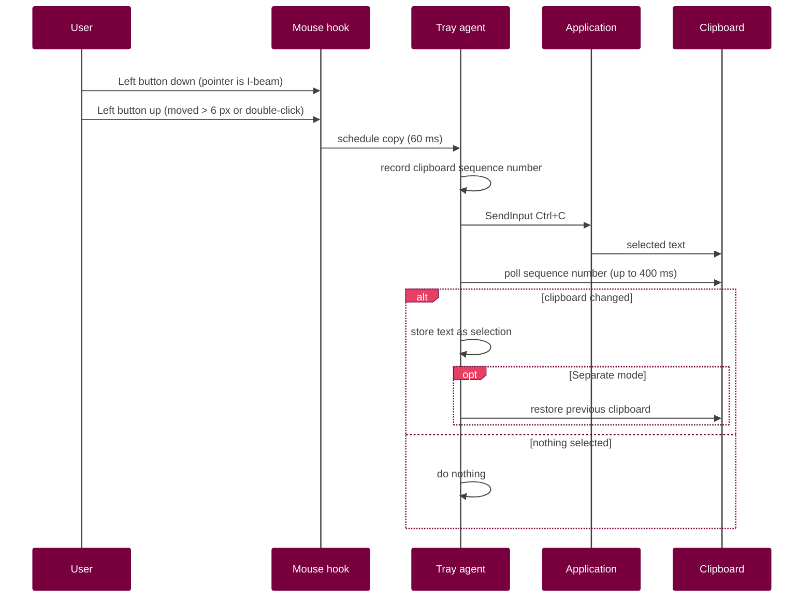
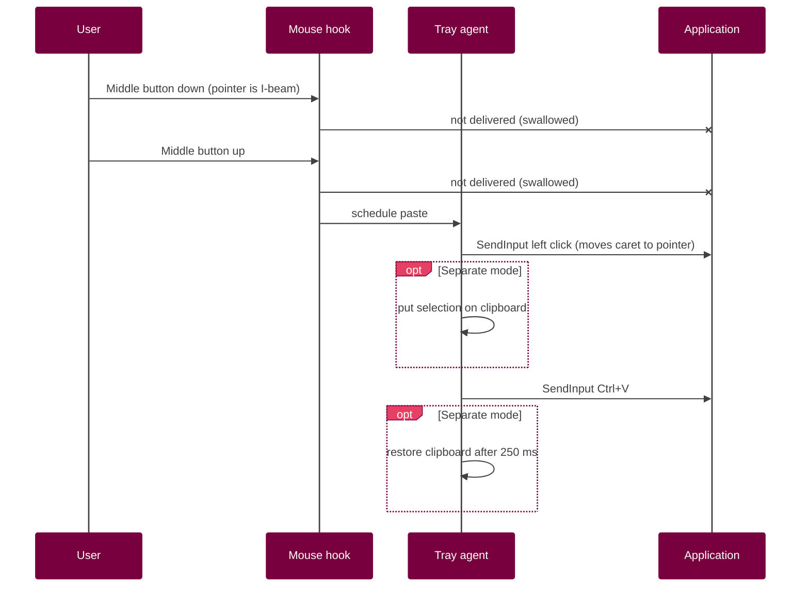

# Linux X11 Selection and Copy-Paste for Windows OS

Select text to copy it, middle-click to paste it. The way it works on a Linux desktop, now on Windows.

If you spend your days switching between Linux and Windows, you know the feeling: you select a line in a
terminal on Linux, middle-click into an editor, done. Then you try the same thing on Windows and nothing
happens. I got tired of that, so I made Linux Selection.

It's a single executable with no dependencies. It installs itself as a Windows service, sits in the
notification area, and can be removed from **Settings > Apps** like any other program.

| | |
|---|---|
| Version | 1.0.1 |
| Works on | Windows 10 and 11, 64- and 32-bit |
| Needs | .NET Framework 4.8, which Windows already has |
| Network access | None |
| Author | Aleksandr Igumenov |
| License | [Apache 2.0](LICENSE), please credit the author ([NOTICE](NOTICE)) |

---

## Table of contents

1. [Overview](#1-overview)
2. [Features](#2-features)
3. [Requirements](#3-requirements)
4. [Installation](#4-installation)
5. [Usage](#5-usage)
6. [Configuration](#6-configuration)
7. [Uninstallation](#7-uninstallation)
8. [Command-line reference](#8-command-line-reference)
9. [Architecture](#9-architecture)
10. [Design decisions and rationale](#10-design-decisions-and-rationale)
11. [Windows APIs used](#11-windows-apis-used)
12. [Files, registry and system changes](#12-files-registry-and-system-changes)
13. [Security and privacy](#13-security-and-privacy)
14. [Building from source](#14-building-from-source)
15. [Project structure](#15-project-structure)
16. [Version history](#16-version-history)
17. [Troubleshooting](#17-troubleshooting)
18. [FAQ](#18-faq)
19. [Known limitations](#19-known-limitations)
20. [Contributing](#20-contributing)
21. [License](#21-license)

---

## 1. Overview

### 1.1 How it works on X11

X11 keeps two separate text buffers, and most Wayland desktops copy that behaviour:

- the **PRIMARY selection**, which fills up as soon as you select text with the mouse and is pasted with the
  middle button wherever the pointer is;
- the **CLIPBOARD**, which you fill with `Ctrl+C` and paste with `Ctrl+V`.

The first one is what makes copying on Linux feel effortless. Select, middle-click, and your regular
clipboard isn't even touched.

### 1.2 What's missing on Windows

Windows only has the clipboard. The middle button means "open in new tab" or "autoscroll", never "paste".
There's no setting for it and no built-in way to add it.

### 1.3 What this program does

Linux Selection adds that behaviour on top of Windows without replacing anything:

- selecting text with the mouse copies it;
- middle-clicking in a text field pastes it at the pointer;
- if you want the two buffers kept apart like on X11, turn on *Separate selection buffer* and `Ctrl+C` /
  `Ctrl+V` will keep working on their own;
- anywhere that isn't a text field, the middle button does what it always did.

A few rules I set for myself while writing it: if you didn't select anything, the clipboard stays as it was.
No runtime to install, no scripting engine, no third-party libraries. And it should install and uninstall
cleanly, like a proper Windows program.

What it doesn't try to do: clipboard history, syncing between computers, or support for anything older than
Windows 10.

---

## 2. Features

- Copies on select: dragging, double-clicking a word or triple-clicking a line copies the selection.
- Pastes on middle-click, at the mouse position, but only over text fields. Links, tabs and autoscroll
  behave normally.
- Two modes. By default the selection goes straight to the clipboard. In separate mode it's kept in its own
  buffer, just like X11 PRIMARY.
- Leaves terminals, Remote Desktop and virtual machine windows alone.
- Runs as a Windows service, starts at boot and keeps itself running for every logged-in user.
- Tray icon with a menu, and `Ctrl+Alt+P` to switch it on and off.
- Its own installer, with a silent mode, Start menu shortcuts and a normal entry in *Settings > Apps*.

---

## 3. Requirements

Windows 10 or 11 (Server with Desktop Experience works too). .NET Framework 4.8 is part of all of these, so
there's nothing to install. You'll need administrator rights to install and uninstall, but not for everyday
use. And, of course, a mouse with a middle button or a clickable wheel.

---

## 4. Installation

### 4.1 The normal way

1. Download `LinuxSelectionSetup.exe` from the [latest release](../../releases/latest).
2. Run it, click **Yes**, and confirm the UAC prompt.

After a few seconds a green icon appears next to the clock. That's it.

If you want to check the download, compare its checksum with the one in the release notes:
`certutil -hashfile LinuxSelectionSetup.exe SHA256`

> The installer isn't code-signed, so SmartScreen may say *"Windows protected your PC"*.
> Click **More info > Run anyway**, or build it yourself from the source (see [section 14](#14-building-from-source)).

### 4.2 What the installer actually does

It stops any older version that's running and copies the program to
`C:\Program Files\LinuxSelection\LinuxSelection.exe`. Then it registers the `LinuxSelection` service with
automatic start. If the service ever crashes, Windows restarts it after 5 seconds, then 5 again, then 30.
It also gives regular users permission to start and stop this one service, so the tray menu works without
UAC prompts.

Finally it adds a **Linux Selection** folder to the Start menu, registers the program in *Settings > Apps*
and starts the service, which in turn starts the tray icon in your session.

### 4.3 Silent installation

For Group Policy, Intune, SCCM or your own scripts:

```cmd
LinuxSelectionSetup.exe --install /quiet
```

`/silent` and `/s` work too. Run it elevated if you don't want a UAC prompt. The exit codes are listed in
[section 8](#8-command-line-reference).

### 4.4 Upgrading

Just run the newer installer. It notices the existing installation, tells you which version you have and
replaces it. Your settings stay as they were.

---

## 5. Usage

### 5.1 Copy and paste

Select text with the mouse (drag, double-click a word, triple-click a line) and it's copied. Middle-click
inside a text field and it's pasted where the pointer is. Middle-click on a link, a tab or an empty area and
Windows does whatever it normally does.

### 5.2 The tray icon

The colour tells you the state at a glance: **green** means it's working, **grey** means you switched it
off, and **red** means the service is stopped.

Double-click the icon to switch it on or off. Right-click for the menu:

| Menu item | What it does |
|---|---|
| Service: running / stopped | Just shows the current state. |
| Enabled (`Ctrl+Alt+P`) | Turns copy/paste on or off. The service keeps running. |
| Separate selection buffer (Linux style) | Switches between the two modes described below. |
| Start service / Stop service | Starts or stops the Windows service. The icon stays, so you can start it again. |
| Install as service... | Only appears if the service isn't installed. |
| Stop and exit | Stops the service and closes the icon. |

### 5.3 Start menu

**Linux Selection** starts the program. If it's already running, you'll get a short notification, and if the
service was stopped it gets started again. **Uninstall Linux Selection** asks once and then removes everything.

### 5.4 The two modes

In the default mode, selecting text simply replaces what's on the clipboard. So after selecting, both
middle-click and `Ctrl+V` paste the selection. This is the "copy on select" behaviour most people want.

In separate mode, the selection goes into its own buffer and your clipboard is put back the way it was.
Middle-click pastes the selection, `Ctrl+V` pastes whatever you last copied with `Ctrl+C`. That's exactly how
PRIMARY and CLIPBOARD behave on X11.

---

## 6. Configuration

Everything you can change is in the tray menu. The choices are saved per user in the registry under
`HKCU\Software\LinuxSelection`:

| Value | Type | Default | Meaning |
|---|---|---|---|
| `Enabled` | DWORD | `1` | Copy/paste switched on |
| `Separate` | DWORD | `0` | Separate selection buffer |

Two more things can be changed in the source, at the top of the `TrayAgent` class: the list of ignored
programs (`Excluded`, by default `conhost.exe`, `WindowsTerminal.exe`, `mstsc.exe`, `VirtualBoxVM.exe` and
`vmconnect.exe`) and how far the mouse has to move before it counts as a selection (`DragThreshold`, 6 pixels).

---

## 7. Uninstallation

Use whichever is handy:

- **Settings > Apps > Linux Selection > Uninstall**
- **Start menu > Linux Selection > Uninstall Linux Selection**
- or silently: `"C:\Program Files\LinuxSelection\LinuxSelection.exe" --uninstall /quiet`

It stops and removes the service, closes the tray icon for every user, and deletes the Start menu folder, the
*Apps* entry, the settings, the program folder and the log. Nothing is left behind.

---

## 8. Command-line reference

The installer, the service and the tray program are all the same file, started with different arguments.

| Command | Description |
|---|---|
| `LinuxSelectionSetup.exe` | Runs the installer (when started from anywhere except the install folder). |
| `LinuxSelection.exe` | Runs the tray program (when started from the install folder). |
| `--install [/quiet]` | Installs or upgrades. Asks for admin rights if needed. |
| `--uninstall [/quiet] [/confirm]` | Uninstalls. `/confirm` asks first; the Start menu shortcut uses it. |
| `--service` | Used by Windows to start the service. Don't run it yourself. |
| `--make-icon <file.ico>` | Writes the program icon. Only needed when building. |
| `--parent <pid>` | Internal, used when the program restarts itself with admin rights. |

Exit codes are the same ones Windows Installer uses, so deployment tools understand them out of the box:

| Code | Meaning |
|---|---|
| `0` | Done |
| `1223` | The UAC prompt was declined |
| `1602` | Cancelled by the user |
| `1603` | Something went wrong (see the log) |

---

## 9. Architecture

### 9.1 Components



There are three roles, and they're all the same executable:

| Part | Runs as | Session | Job |
|---|---|---|---|
| Service | LocalSystem | 0 | Starts with Windows and keeps a tray program running in every active session. |
| Tray program | The logged-in user | 1..n | Watches the mouse, copies and pastes, shows the icon and menu. |
| Installer | Administrator | User | Installs, upgrades and uninstalls. |

### 9.2 What happens when you select text



### 9.3 What happens when you middle-click



### 9.4 How the service keeps things running

Every 3 seconds the service looks at the active user sessions (`WTSEnumerateSessions`). If one of them has no
tray program, it takes that user's token (`WTSQueryUserToken`) and starts the program on their desktop
(`winsta0\default`). To avoid a restart loop, it won't try the same session more than once every 10 seconds.
If the service itself crashes, Windows restarts it.

### 9.5 The tray program's lifecycle

Only one copy runs per session; a named mutex (`Local\LinuxSelection_Agent`) takes care of that. If you start
it again from the Start menu, the new copy pokes the running one through a named event
(`Local\LinuxSelection_Show`) and exits. The running one shows a notification and starts the service if it was
stopped. The state is refreshed every 2 seconds and whenever you open the menu. Copy and paste only work when
*Enabled* is ticked and the service is running.

---

## 10. Design decisions and rationale

This is the part I'd want to read if I were looking at someone else's project: why things are the way they are.

### 10.1 Why C# on .NET Framework 4.8

I wanted something that runs on any Windows machine without installing anything, and that anyone can build
without installing anything either. I looked at a few options:

- **AutoHotkey** was my first prototype, and it works, but it needs its own interpreter.
- **PowerShell** starts slowly, runs into execution policies and isn't great for a mouse hook that has to
  react instantly.
- **C or C++** would need a compiler that Windows doesn't ship with, and the tray UI takes much more code.
- **.NET 6 or newer** isn't installed by default, and self-contained builds are huge.

.NET Framework 4.8 is already on every Windows 10 and 11 machine, and so is its C# compiler (`csc.exe`). That
settled it. P/Invoke gives full access to the Win32 API, and WinForms handles the tray icon.

### 10.2 Why C# 5 syntax

The compiler that comes with Windows understands C# 5 and nothing newer. So the code skips string
interpolation, `=>` members, `out var` and `nameof`. It's a small price for "anyone can build this with what's
already on their machine".

### 10.3 Why one executable

Installer, service and tray program are one file. They can never end up with different versions, the release is
a single download, and the installer can simply copy itself into place.

### 10.4 Why a service and a separate tray program

Since Windows Vista, services live in session 0, cut off from the user's desktop. A service can't see your
mouse, your clipboard or your notification area, so it can't do this job on its own. The usual solution, and
the one I went with, is a small service that starts and watches a helper in each user session. That gives you
autostart without per-user startup entries, automatic recovery if the helper dies, and it works with several
users logged in at once (fast user switching, Remote Desktop).

### 10.5 Why a low-level mouse hook

`WH_MOUSE_LL` sees mouse input for every application without injecting code into any of them. It's also the
only practical way to swallow the middle-click over a text field, so the application doesn't get both a paste
and its own middle-click action. The program ignores input it generates itself (the `LLMHF_INJECTED` flag),
otherwise it would keep reacting to its own clicks.

### 10.6 How it knows you're over a text field

Windows has no simple "is the pointer over editable text?" call. UI Automation can tell you, but it's slow,
differs between frameworks and sometimes blocks. The mouse cursor, on the other hand, turns into an I-beam over
text in practically every program, and checking it is instant. The cursor is checked when you press the button,
so a selection that starts on text still counts even if you release the button somewhere else.

### 10.7 Why it copies by sending `Ctrl+C`

Reading the selection directly would need a different API for every kind of application. Sending `Ctrl+C` works
everywhere copying works. To tell whether anything was actually copied, the program compares the clipboard
sequence number (`GetClipboardSequenceNumber`) before and after. If nothing changed, it leaves the clipboard
alone. It also lets go of `Shift` first, because `Ctrl+Shift+C` means something different in browsers and
terminals, and it doesn't copy at all while `Alt` or `Win` is held down.

### 10.8 Why it clicks before pasting

On Linux, middle-click pastes where the mouse is, not where the text cursor happens to be. So the program first
sends a left click to move the cursor there, then `Ctrl+V`. Both go through `SendInput`, which Windows treats
the same as real mouse and keyboard input.

### 10.9 Why some programs are excluded

In a terminal `Ctrl+C` stops the running program, which is the last thing you want after selecting some text.
Windows Terminal also has its own `copyOnSelect` option. Remote Desktop and virtual machine windows pass input
to another system that already handles selections its own way. So the program stays out of all of these.

### 10.10 Why regular users can start and stop the service

Normally only administrators can do that. The installer adds a permission entry that lets interactive users
(`IU`) start (`RP`) and stop (`WP`) this one service, and nothing more. Changing or deleting it still needs
admin rights. That's what lets the tray menu work without UAC prompts. If it fails anyway, the program falls back
to `sc.exe` with a UAC prompt.

### 10.11 Why it goes into Program Files

The service runs as LocalSystem. If its file were somewhere users can write to, anyone could swap it out and get
full control of the machine. Only administrators can write to `C:\Program Files`, which closes that hole.

### 10.12 Why there's no MSI, WiX or Inno Setup

All of those are either third-party tools or need their own build setup. The installer only has to do a handful
of things, and Windows can do all of them itself: `sc.exe` for the service, the registry for the *Apps* entry,
and the built-in `WScript.Shell` object for the shortcuts. Keeping it in the same code means one less thing to
build.

### 10.13 How it shows up in Settings > Apps

Windows builds that list from `HKLM\SOFTWARE\Microsoft\Windows\CurrentVersion\Uninstall`. The installer writes
the standard values there (name, version, publisher, icon, size, uninstall commands, and flags that hide the
Modify and Repair buttons). It always writes to the 64-bit view of the registry, so the entry ends up in the
right place regardless of how the program was compiled.

### 10.14 How it gets admin rights only when needed

The program isn't marked as "always run as administrator", so the tray program runs with normal rights. When
you install or uninstall, it restarts itself with the `runas` verb, which brings up the UAC prompt. It passes its
own process ID along, so the elevated copy knows not to close it while shutting down the other instances.

### 10.15 How the uninstaller deletes itself

A running program can't delete its own file. So once everything else is done, the uninstaller starts a hidden
`cmd.exe` that waits a few seconds for it to exit and then removes the folder. It tries twice, just in case.

### 10.16 Why the icon is drawn in code

The tray icons (green, grey, red) are drawn at runtime with GDI+. When building, the same drawing code writes a
proper multi-size `.ico` file (16 to 256 pixels), which the compiler embeds into the program. No image files in
the repository, and the icon can't drift out of sync with the code.

### 10.17 Why the Windows Installer exit codes

Intune, SCCM and similar tools already know what `1602` and `1603` mean. Using the same codes means they report
success, cancellation and failure correctly without any extra setup.

### 10.18 Why it detects double-clicks on the icon itself

The usual WinForms `DoubleClick` event only fires if Windows tells the icon about the double-click, and Windows
11 doesn't always do that (icons hidden behind the arrow in the taskbar are a common case). Since 1.0.1 the
program just counts two clicks within the system double-click time (`SystemInformation.DoubleClickTime`) on its
own, which works no matter how Windows reports them.

---

## 11. Windows APIs used

For anyone reading the code, here's what comes from where:

| API | Library | Used for |
|---|---|---|
| `SetWindowsHookEx(WH_MOUSE_LL)`, `CallNextHookEx`, `UnhookWindowsHookEx` | user32 | The global mouse hook |
| `GetCursorInfo`, `LoadCursor(IDC_IBEAM)` | user32 | Checking for the text cursor |
| `SendInput` | user32 | Sending clicks and key presses |
| `GetClipboardSequenceNumber` | user32 | Telling whether a copy happened |
| `GetDoubleClickTime`, `GetAsyncKeyState` | user32 | Double-clicks and modifier keys |
| `RegisterHotKey`, `PostMessage` | user32 | `Ctrl+Alt+P` and messages between threads |
| `GetForegroundWindow`, `GetWindowThreadProcessId` | user32 | Finding the active program |
| `OpenProcess`, `QueryFullProcessImageName` | kernel32 | Getting its file name for the exclusion list |
| `WTSEnumerateSessions`, `WTSQueryUserToken` | wtsapi32 | Finding user sessions |
| `DuplicateTokenEx`, `CreateProcessAsUser` | advapi32 | Starting the tray program in a session |
| `CreateEnvironmentBlock` | userenv | Giving it the user's environment |
| `ServiceBase`, `ServiceController` | .NET | Running and controlling the service |
| `sc.exe` | Windows | Creating the service and setting its permissions |
| `WScript.Shell` | Windows (COM) | Start menu shortcuts |

---

## 12. Files, registry and system changes

This is everything the installer touches. The uninstaller removes all of it.

| What | Where |
|---|---|
| Program | `C:\Program Files\LinuxSelection\LinuxSelection.exe` |
| Log | `C:\ProgramData\LinuxSelection\service.log` |
| Service | `LinuxSelection` (shown as *Linux Selection*) |
| Start menu | `C:\ProgramData\Microsoft\Windows\Start Menu\Programs\Linux Selection\` |
| Apps entry | `HKLM\SOFTWARE\Microsoft\Windows\CurrentVersion\Uninstall\LinuxSelection` |
| Your settings | `HKCU\Software\LinuxSelection` |

---

## 13. Security and privacy

A program that watches your mouse and reads your clipboard should be upfront about what it does, so here it is.

It never connects to the network. No telemetry, no update checks, no analytics. Whatever you select stays in the
tray program's memory (and only in separate mode); it's never written to disk or to the log.

The tray program, which is the part that deals with your input, runs with your normal user rights. Only the small
service runs as LocalSystem, and all it does is start the tray program; it never sees your data. Its file sits in
`Program Files`, where only administrators can change it. The one permission the installer adds lets users start
and stop this single service, nothing else. No code is injected into other programs.

And the whole thing is one source file that you can read and compile yourself with what's already on your
computer.

If you find a security problem, please report it privately through GitHub's *Report a vulnerability* button
rather than opening a public issue.

---

## 14. Building from source

### 14.1 What you need

Just Windows 10 or 11. No Visual Studio, no SDK, no NuGet.

### 14.2 Building

Open a command prompt in the folder with `LinuxSelection.cs` and run:

```cmd
set CSC=%WINDIR%\Microsoft.NET\Framework64\v4.0.30319\csc.exe
set REFS=/r:System.Windows.Forms.dll /r:System.Drawing.dll /r:System.ServiceProcess.dll

rem 1. Build a helper and let it generate the application icon
"%CSC%" /nologo /target:winexe /out:icongen.exe %REFS% LinuxSelection.cs
start "" /wait icongen.exe --make-icon app.ico

rem 2. Build the installer with the icon embedded
"%CSC%" /nologo /target:winexe /optimize+ /win32icon:app.ico /out:LinuxSelectionSetup.exe %REFS% LinuxSelection.cs

del icongen.exe app.ico
```

On 32-bit Windows, use `Framework` instead of `Framework64`.

### 14.3 Why it's built twice

The icon is drawn by the program's own code. So the first build makes a throwaway copy whose only job is to
write `app.ico`, and the second build embeds that icon into the real installer. It keeps image files out of the
repository.

### 14.4 Checking that it works

1. Run `LinuxSelectionSetup.exe` and install.
2. In `services.msc`, *Linux Selection* should be *Running* with start type *Automatic*.
3. The tray icon should be green. Select some text in Notepad and middle-click somewhere else in the document.
4. *Settings > Apps* should list *Linux Selection 1.0.1*.
5. Uninstall, then check that nothing from [section 12](#12-files-registry-and-system-changes) is left.

---

## 15. Project structure

```
linux-selection/
├── LinuxSelection.cs        the whole program
├── LICENSE                  Apache License 2.0
├── NOTICE                   attribution that must be kept when redistributing
└── README.md                this file
```

The installer itself isn't kept in the repository. Each version's `LinuxSelectionSetup.exe` is attached to its
[release](../../releases) instead, so every download matches a tagged version of the source.

Inside `LinuxSelection.cs` the code is split into classes, each with one job:

| Class | Job |
|---|---|
| `Program` | Entry point, command-line handling, constants, logging |
| `LauncherService` | The Windows service that keeps tray programs running |
| `Svc` | Checking, starting and stopping the service |
| `Setup` | Installer, uninstaller, Start menu, *Apps* entry |
| `Logo` | Drawing the icon and writing the `.ico` file |
| `TrayAgent` | Mouse hook, copy and paste, tray icon and menu, settings |
| `MessageWindow` | Hidden window for the hotkey and messages between threads |
| `Wts` | Finding sessions and starting the tray program in them |
| `Native` | Win32 declarations |

---

## 16. Version history

Version numbers follow [Semantic Versioning](https://semver.org/).

**1.0.1** (2026-10-12)
Double-clicking the tray icon didn't switch *Enabled* on some Windows 11 machines. The program now detects the
double-click itself instead of relying on Windows to report it.

**1.0.0** (2026-10-12)
First release: copy on select, middle-click paste, separate selection buffer, Windows service, tray menu,
`Ctrl+Alt+P`, installer with silent mode, Start menu shortcuts and uninstall from *Settings > Apps*.

Release notes and installers for every version are on the [Releases](../../releases) page.

---

## 17. Troubleshooting

| Problem | What to do |
|---|---|
| No tray icon after installing | Give it a few seconds. Then check in `services.msc` that the service is running, and look at the log. |
| The icon is red | The service is stopped. Choose **Start service** in the menu. |
| The icon is grey | It's switched off. Press `Ctrl+Alt+P` or tick **Enabled**. |
| It doesn't work in one particular program | That program may be running as administrator, be on the exclusion list, or not use the standard text cursor. See [section 19](#19-known-limitations). |
| Middle-click opens links instead of pasting | That's intended. Pasting only happens over text fields. |
| My clipboard keeps getting replaced | Turn on **Separate selection buffer (Linux style)**. |
| `Ctrl+Alt+P` does nothing | Some other program has grabbed the same shortcut. Use the menu instead. |
| Double-clicking the icon does nothing | Fixed in 1.0.1. Install the latest release. |
| The installer says 1603 | The log explains why. |
| No Start menu shortcuts | Your organisation may block `WScript.Shell`. The log will say so. Everything else still works. |

The log lives in `C:\ProgramData\LinuxSelection\service.log`. It records when the service starts and stops,
when the tray program is launched, installation results and errors.

---

## 18. FAQ

**Does selecting with the keyboard (Shift + arrows) work too?**
No, only mouse selections. That's how it works on Linux as well.

**Will it slow my computer down?**
No. The hook does a tiny amount of work per mouse event. Anything heavier only happens after you select
something or middle-click.

**What if several people are logged in?**
Each of them gets their own tray program with their own settings.

**Can I use it without the service?**
The service is what starts the program at boot and keeps it alive. If you stop it, the icon stays (red) but
copy and paste are paused until you start it again.

**Why is my antivirus or SmartScreen suspicious?**
The installer isn't signed, and it uses a global mouse hook and simulated input, the same techniques
automation tools use. The full source is here, so you can read it and build it yourself.

---

## 19. Known limitations

- Windows won't let a normal program send input to programs started with *Run as administrator* (this is
  called UIPI), so it doesn't work in those windows.
- Programs that draw their own text cursor instead of using the standard one (some Electron and Java apps,
  games) aren't recognised.
- Windows has only one clipboard. In the default mode your selection replaces it. Separate mode works around
  this by putting the clipboard back after each copy and paste, but clipboard history tools may still catch the
  selection in between.
- Programs that don't support `Ctrl+C` can't be copied from.
- The UAC prompt and the sign-in screen are deliberately isolated by Windows, so it doesn't work there.

---

## 20. Contributing

Bug reports and pull requests are welcome. A few things I'd like to keep as they are:

- no dependencies, so it still builds with the `csc.exe` that comes with Windows;
- C# 5 syntax only (see [section 10.2](#102-why-c-5-syntax));
- English everywhere: code, comments, interface and documentation;
- one source file, unless there's a really good reason to split it.

When you send a change, please mention how you tested it ([section 14.4](#144-checking-that-it-works) is a
good starting point).

---

## 21. License

Copyright 2026 Aleksandr Igumenov. Licensed under the [Apache License 2.0](LICENSE).

You're free to use this program for anything, personal or commercial, to change it and to share it, as is or
modified. I only ask one thing in return: credit me as the author of the original idea. If you pass it on,
keep the text from the [NOTICE](NOTICE) file somewhere visible, whether that's a NOTICE file of your own, your
documentation or an "About" screen. Include the [LICENSE](LICENSE) file as well, don't remove the copyright
notices from the code, and mark the files you changed.

As with any open-source software, it comes without warranty.

I chose Apache 2.0 rather than MIT because it has a proper, legally recognised way of requiring attribution
(the NOTICE file, section 4(d) of the license), while still leaving the software free to use, modify and share.
It also includes an explicit patent grant, which MIT doesn't.
