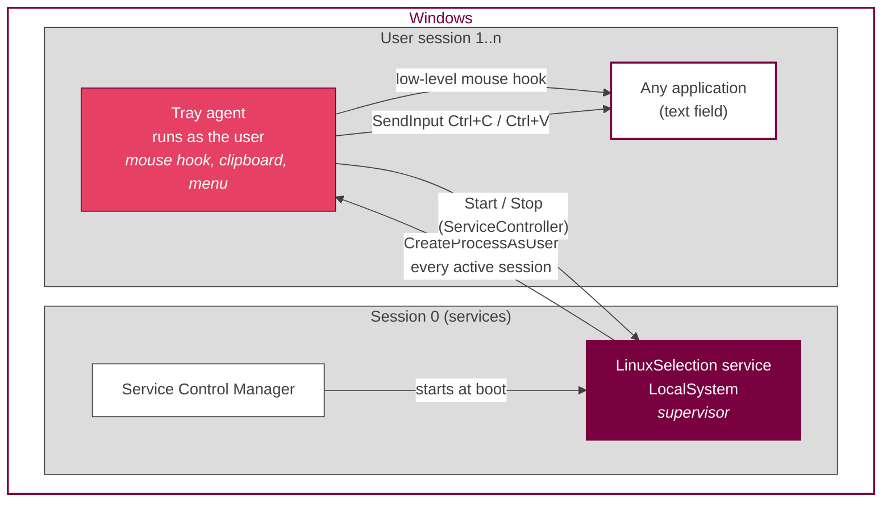
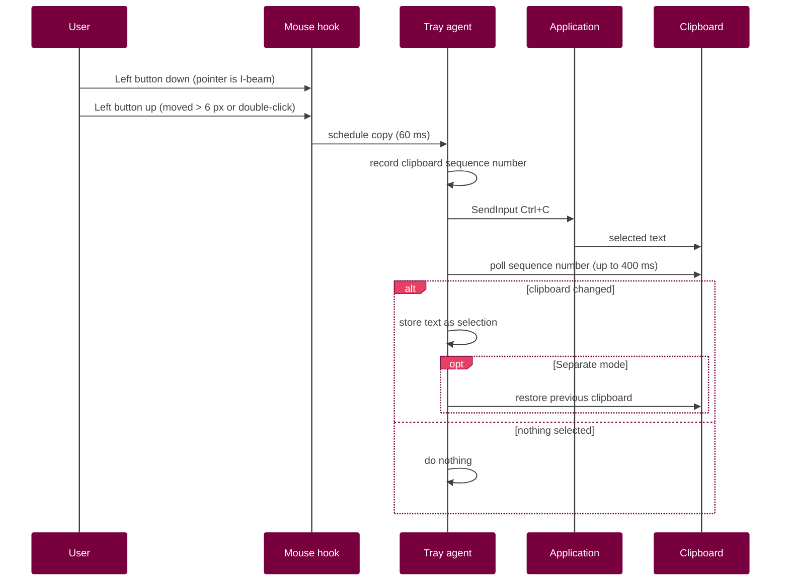
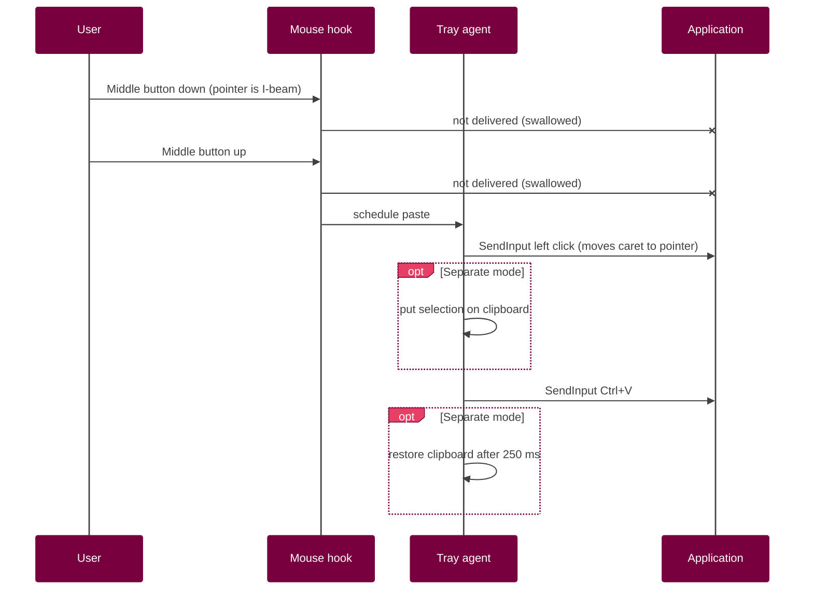

# Linux X11 Selection and Copy-Paste for Windows OS

**The X11 select-copy-paste workflow, implemented for Windows.**

> Select text to copy it. Middle-click to paste it. Exactly as on a Linux desktop.

On X11 this is so natural that Linux users stop noticing it, until they sit at a Windows machine and the
middle button does nothing. Linux Selection implements the X11 *select-copy-paste* model on Windows:
selecting text copies it, and pressing the middle mouse button pastes it at the pointer. It is a single,
dependency-free executable that installs itself as a Windows service, lives in the notification area and
can be removed from **Settings > Apps**.

| | |
|---|---|
| **Version** | 1.0.1 |
| **Platform** | Windows 10 / Windows 11 (x64 and x86) |
| **Runtime** | .NET Framework 4.8 (built into Windows) |
| **Dependencies** | None |
| **Network access** | None |
| **Author** | Aleksandr Igumenov (original idea and implementation) |
| **License** | [Apache 2.0](LICENSE), attribution required ([NOTICE](NOTICE)) |

---

## Table of contents

1. [Overview](#1-overview)
2. [Features](#2-features)
3. [Requirements](#3-requirements)
4. [Installation](#4-installation)
5. [Usage](#5-usage)
6. [Configuration](#6-configuration)
7. [Uninstallation](#7-uninstallation)
8. [Command-line reference](#8-command-line-reference)
9. [Architecture](#9-architecture)
10. [Design decisions and rationale](#10-design-decisions-and-rationale)
11. [Windows APIs used](#11-windows-apis-used)
12. [Files, registry and system changes](#12-files-registry-and-system-changes)
13. [Security and privacy](#13-security-and-privacy)
14. [Building from source](#14-building-from-source)
15. [Project structure](#15-project-structure)
16. [Version history](#16-version-history)
17. [Troubleshooting](#17-troubleshooting)
18. [FAQ](#18-faq)
19. [Known limitations](#19-known-limitations)
20. [Contributing](#20-contributing)
21. [License](#21-license)

---

## 1. Overview

### 1.1 The X11 select-copy-paste model

The X Window System (X11) defines two independent text buffers, and most Wayland compositors keep the same
behaviour for compatibility:

| X11 buffer | Filled by | Pasted with |
|---|---|---|
| **PRIMARY** selection | Simply selecting text with the mouse | **Middle mouse button**, at the pointer position |
| **CLIPBOARD** | An explicit copy command (`Ctrl+C`) | An explicit paste command (`Ctrl+V`), at the caret |

The PRIMARY selection makes copying text a single gesture: select, then middle-click where it should go.
No keyboard is needed and the regular clipboard stays untouched.

### 1.2 The gap on Windows

Windows has only the clipboard, and the middle button has no text meaning. Users who move between Linux
and Windows constantly reach for the middle button and find that nothing happens.

### 1.3 The solution

Linux Selection implements the X11 select-copy-paste model on Windows without replacing any Windows
component and without requiring additional software:

| X11 behaviour | Linux Selection on Windows |
|---|---|
| Selecting text fills PRIMARY | Selecting text copies it automatically |
| Middle-click pastes PRIMARY at the pointer | Middle-click over a text field pastes at the pointer |
| PRIMARY and CLIPBOARD are independent | *Separate selection buffer* mode keeps `Ctrl+C`/`Ctrl+V` independent |
| Middle-click elsewhere keeps its meaning | Links, tabs and autoscroll work as usual |

### Goals

- Reproduce the X11 select-copy-paste behaviour as closely as Windows allows.
- Never get in the way: if nothing is selected, the clipboard is not touched; outside text fields the
  middle button keeps its normal meaning (open link in new tab, autoscroll, close tab).
- Zero dependencies: no runtime to install, no scripting engine, no third-party libraries.
- Professional lifecycle: proper installer, service, Start menu entries, clean uninstall.

### Non-goals

- Clipboard history or synchronization between devices.
- Support for Windows versions older than Windows 10.

---

## 2. Features

| Feature | Description |
|---|---|
| **Select to copy** | Text selected with the mouse (drag, double-click, triple-click) is copied automatically. |
| **Middle-click paste** | Middle-click over a text field pastes at the mouse position. |
| **Context awareness** | Acts only when the mouse pointer is the text cursor (I-beam); elsewhere the middle button works as usual. |
| **Two buffer modes** | *Shared* (default): selection goes to the clipboard. *Separate*: X11 PRIMARY/CLIPBOARD behaviour, `Ctrl+C`/`Ctrl+V` untouched. |
| **Application exclusions** | Terminals, remote desktop and virtual machine windows are ignored. |
| **Windows service** | Starts at boot, supervises the tray agent in every user session, restarts it if it crashes. |
| **Tray icon and menu** | Status colours, enable/disable, buffer mode, start/stop service, stop and exit. |
| **Global hotkey** | `Ctrl+Alt+P` toggles the feature on and off. |
| **Self-contained installer** | Interactive and silent modes, in-place upgrades, Start menu shortcuts. |
| **Standard uninstall** | Listed in **Settings > Apps**; removes every trace it created. |

---

## 3. Requirements

| Requirement | Notes |
|---|---|
| Windows 10 or Windows 11 | Server editions with Desktop Experience also work. |
| .NET Framework 4.8 | Included in all supported Windows versions. |
| Administrator rights | Only for installation and uninstallation. Daily use does not require them. |
| A mouse with a middle button | Or a wheel that can be clicked. |

---

## 4. Installation

### 4.1 Interactive installation

1. Download `LinuxSelectionSetup.exe` from the [latest release](../../releases/latest).
   Optionally verify its SHA-256 checksum against the one published in the release notes:
   `certutil -hashfile LinuxSelectionSetup.exe SHA256`
2. Run it and click **Yes** in the confirmation dialog.
3. Confirm the User Account Control (UAC) prompt.

The tray icon appears within a few seconds.

> **SmartScreen warning.** The installer is not code-signed, so Windows SmartScreen may show
> *"Windows protected your PC"*. Choose **More info > Run anyway**, or build the installer yourself
> from the source code (see [Building from source](#14-building-from-source)).

### 4.2 What the installer does

1. Stops the existing service and tray agents, if an earlier version is installed.
2. Copies the program to `C:\Program Files\LinuxSelection\LinuxSelection.exe`.
3. Creates or updates the `LinuxSelection` Windows service:
   - start type **Automatic**;
   - recovery: restart after 5 s, 5 s and 30 s, failure counter reset after 24 h;
   - permissions that allow interactive users to start and stop it without UAC.
4. Creates the Start menu folder **Linux Selection** with a launcher and an uninstaller.
5. Registers the application in **Settings > Apps** (Add/Remove Programs).
6. Starts the service, which launches the tray agent in the user session.

### 4.3 Silent installation

For scripted deployment (Group Policy, Intune, SCCM, provisioning scripts):

```cmd
LinuxSelectionSetup.exe --install /quiet
```

`/silent` and `/s` are accepted as synonyms of `/quiet`. Run the command from an elevated context
to avoid the UAC prompt. Exit codes are listed in the [command-line reference](#8-command-line-reference).

### 4.4 Upgrading

Run a newer `LinuxSelectionSetup.exe`. The installer detects the existing installation, shows the installed
version and upgrades in place. User settings are preserved.

---

## 5. Usage

### 5.1 Copy and paste

| Action | Result |
|---|---|
| Drag over text with the left button | Selection is copied |
| Double-click a word / triple-click a line | Selection is copied |
| Middle-click inside a text field | Text is pasted at the mouse position |
| Middle-click on a link, tab or empty area | Normal Windows behaviour |

### 5.2 Tray icon

| Colour | Meaning |
|---|---|
| Green | Active |
| Grey | Disabled with the *Enabled* checkbox or `Ctrl+Alt+P` |
| Red | Service stopped |

Double-clicking the icon toggles *Enabled*. Right-clicking opens the menu:

| Menu item | Action |
|---|---|
| **Service: running / stopped** | Current service status (read-only). |
| **Enabled** `Ctrl+Alt+P` | Turns the feature on or off. The service keeps running. |
| **Separate selection buffer (Linux style)** | Switches between shared and separate buffer modes. |
| **Start service** | Starts the Windows service. |
| **Stop service** | Stops the Windows service. The tray icon stays so the service can be started again. |
| **Install as service...** | Shown only when the service is not installed. |
| **Stop and exit** | Stops the service and closes the tray agent. |

### 5.3 Start menu

| Shortcut | Action |
|---|---|
| **Linux Selection** | Starts the tray agent and the service. If already running, shows a notification and starts the service if it was stopped. |
| **Uninstall Linux Selection** | Asks for confirmation and uninstalls. |

### 5.4 Buffer modes

| | Shared (default) | Separate (Linux style) |
|---|---|---|
| Selecting text | Replaces the clipboard | Stored in a private buffer; clipboard restored |
| `Ctrl+V` after selecting | Pastes the selection | Pastes the previous clipboard content |
| Middle-click | Pastes the clipboard | Pastes the private buffer |
| X11 equivalent | PRIMARY and CLIPBOARD merged | PRIMARY and CLIPBOARD independent |
| Best for | Users who want "copy on select" | Users who want exact X11 behaviour |

---

## 6. Configuration

Settings are stored per user in the registry and are changed from the tray menu.

| Key | Value | Type | Default | Meaning |
|---|---|---|---|---|
| `HKCU\Software\LinuxSelection` | `Enabled` | DWORD | `1` | Feature enabled |
| `HKCU\Software\LinuxSelection` | `Separate` | DWORD | `0` | Separate selection buffer |

Compile-time settings at the top of the `TrayAgent` class in `LinuxSelection.cs`:

| Setting | Default | Meaning |
|---|---|---|
| `Excluded` | `conhost.exe`, `WindowsTerminal.exe`, `mstsc.exe`, `VirtualBoxVM.exe`, `vmconnect.exe` | Processes where the feature is inactive |
| `DragThreshold` | `6` px | Minimum mouse movement that counts as a selection drag |

---

## 7. Uninstallation

Any of the following removes Linux Selection completely:

- **Settings > Apps > Linux Selection > Uninstall**
- **Start menu > Linux Selection > Uninstall Linux Selection**
- Silent: `"C:\Program Files\LinuxSelection\LinuxSelection.exe" --uninstall /quiet`

The uninstaller stops and deletes the service, closes tray agents in all sessions, and removes the
Start menu folder, the *Apps* entry, the user settings, the program folder and the log folder.

---

## 8. Command-line reference

The same executable provides every mode.

| Command | Description |
|---|---|
| `LinuxSelectionSetup.exe` | Interactive installer (any location other than the install folder). |
| `LinuxSelection.exe` | Tray agent (when started from the install folder). |
| `--install [/quiet]` | Install or upgrade. Elevates itself if required. |
| `--uninstall [/quiet] [/confirm]` | Uninstall. `/confirm` asks first (used by the Start menu shortcut). |
| `--service` | Service entry point. Started by the Service Control Manager only. |
| `--make-icon <file.ico>` | Writes the application icon. Used during the build. |
| `--parent <pid>` | Internal: process that requested elevation, excluded from shutdown. |

| Exit code | Meaning |
|---|---|
| `0` | Success |
| `1223` | UAC prompt declined (`ERROR_CANCELLED`) |
| `1602` | Cancelled by the user (`ERROR_INSTALL_USEREXIT`) |
| `1603` | Installation or uninstallation failed (`ERROR_INSTALL_FAILURE`) |

Exit codes follow Windows Installer conventions so deployment tools interpret them correctly.

---

## 9. Architecture

### 9.1 Components



| Component | Runs as | Session | Responsibility |
|---|---|---|---|
| **Service** | LocalSystem | 0 | Starts with Windows; launches and supervises a tray agent in each active session. |
| **Tray agent** | Logged-on user | 1..n | Mouse hook, copy and paste, clipboard, tray icon, menu, hotkey. |
| **Installer** | Administrator (elevated) | User | Files, service registration, shortcuts, *Apps* entry, uninstall. |

All three are the same executable started with different arguments.

### 9.2 Copy flow



### 9.3 Paste flow



### 9.4 Service supervision

- A timer fires every 3 seconds and enumerates sessions with `WTSEnumerateSessions`.
- For every **active** user session without a running agent, the service obtains the user token
  (`WTSQueryUserToken`) and starts the agent on the interactive desktop (`winsta0\default`).
- A launch in the same session is attempted at most once every 10 seconds to avoid restart loops.
- If the service process itself crashes, the Service Control Manager restarts it (recovery actions).

### 9.5 Agent lifecycle

- **Single instance per session**: a named mutex `Local\LinuxSelection_Agent`.
- **Second launch** (e.g. from the Start menu): signals the running agent through the named event
  `Local\LinuxSelection_Show`; the agent shows a notification and starts the service if it is stopped.
- **Status polling**: every 2 seconds, and whenever the menu opens.
- **Effective state**: the feature is active only when *Enabled* is checked **and** the service is running.

---

## 10. Design decisions and rationale

### 10.1 Language and runtime: C# on .NET Framework 4.8

| Considered | Decision | Reason |
|---|---|---|
| AutoHotkey | Rejected | Requires a third-party interpreter. |
| PowerShell | Rejected | Slow start-up, script execution policies, unsuitable for a low-latency mouse hook. |
| C / C++ | Rejected | Needs a compiler that is not part of Windows; more code for the tray UI. |
| .NET 6+ | Rejected | Runtime not installed by default; self-contained builds are large. |
| **C# / .NET Framework 4.8** | **Chosen** | Runtime **and compiler** (`csc.exe`) ship with Windows. Full Win32 access through P/Invoke, WinForms for the tray. |

### 10.2 C# 5 language level

The compiler that ships with Windows (`%WINDIR%\Microsoft.NET\Framework64\v4.0.30319\csc.exe`) supports
C# 5. The code therefore avoids newer syntax (string interpolation, expression-bodied members, `out var`,
`nameof`). Anyone can build the project without installing Visual Studio or an SDK.

### 10.3 One executable for everything

Installer, service and tray agent are the same file. This guarantees that all parts always have the same
version, makes the repository and the release a single artifact, and lets the installer copy itself.

### 10.4 Service plus per-session agent

Since Windows Vista, services run in **session 0 isolation**: they cannot see the user's desktop, mouse,
clipboard or notification area. A service alone cannot implement this feature. The established pattern,
used by many system utilities, is a service that supervises a helper in each user session. This provides:

- automatic start at boot without per-user autostart entries;
- recovery if the agent crashes or is terminated;
- support for multiple simultaneous users (Fast User Switching, Remote Desktop).

### 10.5 Low-level mouse hook (`WH_MOUSE_LL`)

A global low-level hook observes mouse input for all applications without injecting a DLL into them.
It is also the only practical way to **swallow** the middle-button event over text fields, so applications do
not receive both a paste and their own middle-click action. Events generated by the agent itself are
recognized by the `LLMHF_INJECTED` flag and ignored, preventing feedback loops.

### 10.6 Text-field detection by I-beam cursor

Windows offers no universal "is the pointer over editable text?" query. UI Automation can answer it, but it is
slow, varies between frameworks and can block. The shape of the system cursor is a fast, framework-independent
signal that virtually every application sets correctly over text. The cursor is read at the moment of the
button press, so a drag that starts over text is recognized even if it ends elsewhere.

### 10.7 Copying with a simulated `Ctrl+C`

Reading the selection directly would require application-specific APIs. A simulated `Ctrl+C` works in any
application that supports copying. The **clipboard sequence number** (`GetClipboardSequenceNumber`) reveals
whether anything was copied, so the clipboard is never cleared or altered when nothing was selected. `Shift` is
released before sending `Ctrl+C` (to avoid `Ctrl+Shift+C`, which means something else in browsers and
terminals), and copying is skipped while `Alt` or `Win` is held.

### 10.8 Pasting with a click and `Ctrl+V`

On Linux, middle-click pastes at the pointer, not at the existing caret. A synthetic left click moves the caret
to the pointer first, then `Ctrl+V` pastes. `SendInput` is used because it places events in the system input
stream exactly like real hardware input.

### 10.9 Excluded applications

Terminals interpret `Ctrl+C` as "interrupt the running program", and Windows Terminal has its own
`copyOnSelect` setting. Remote desktop and virtual machine windows forward input to another operating system,
which already has its own selection handling. Acting in these windows would be harmful, so they are excluded.

### 10.10 Service permissions (SDDL)

By default only administrators can start or stop a service. The installer applies a security descriptor
that additionally grants *Interactive Users* (`IU`) the start (`RP`) and stop (`WP`) rights for this service only.
The tray menu can therefore control the service without a UAC prompt, while configuration and deletion
remain restricted to administrators. If the direct call fails, the agent falls back to an elevated `sc.exe`.

### 10.11 Installation into Program Files

The service runs as LocalSystem. If its executable were in a user-writable folder, any user could replace it
and gain system privileges. `C:\Program Files` is writable only by administrators, which closes that
privilege-escalation path.

### 10.12 Built-in installer instead of MSI/WiX/Inno Setup

Installer frameworks are third-party tools or require a separate toolchain. The operations needed here are
few and well defined, and Windows provides all of them: `sc.exe` for the service, the registry for the
*Apps* entry, the built-in `WScript.Shell` COM object for shortcuts. Keeping the installer in the same code
removes an entire build dependency.

### 10.13 Registration in Settings > Apps

Windows lists applications from `HKLM\SOFTWARE\Microsoft\Windows\CurrentVersion\Uninstall`. Writing the
documented values (`DisplayName`, `DisplayVersion`, `Publisher`, `DisplayIcon`, `UninstallString`,
`QuietUninstallString`, `EstimatedSize`, `NoModify`, `NoRepair`) makes the app appear with its icon,
version and size, and lets both users and management tools uninstall it. The 64-bit registry view is used
explicitly so the entry lands in the correct location regardless of process bitness.

### 10.14 Self-elevation

The executable is not marked `requireAdministrator`, so the agent runs with normal user rights. When
installation or uninstallation is requested, it relaunches itself with the `runas` verb. The PID of the
requesting process is passed along so the elevated process does not terminate it while closing agents.

### 10.15 Self-deletion on uninstall

A running executable cannot delete its own file. After all other steps, the uninstaller starts a hidden
`cmd.exe` that waits a few seconds (until the uninstaller and its parent have exited), then removes the
program folder; the removal is attempted twice for robustness.

### 10.16 Generated icon

Icons are drawn at run time with GDI+ (tray icons in three status colours). During the build, the same code
writes a multi-resolution `.ico` (16-256 px, PNG-compressed entries), which the compiler embeds in the
executable. No image files are needed in the repository, and the icon is always consistent with the code.

### 10.17 MSI-compatible exit codes

Deployment tools such as Intune and SCCM interpret Windows Installer codes (`1602`, `1603`). Using them
lets those tools report success, cancellation and failure correctly without custom configuration.

### 10.18 Own double-click detection for the tray icon

The WinForms `NotifyIcon.DoubleClick` event depends on the shell sending a double-click notification to the
tray icon, which Windows 11 does not always do (for example, for icons in the hidden-icons overflow area).
The agent therefore counts two left-button releases within the system double-click time
(`SystemInformation.DoubleClickTime`) itself, which works regardless of how the shell reports the clicks.

---

## 11. Windows APIs used

| API | Library | Purpose |
|---|---|---|
| `SetWindowsHookEx(WH_MOUSE_LL)`, `CallNextHookEx`, `UnhookWindowsHookEx` | user32 | Global mouse hook |
| `GetCursorInfo`, `LoadCursor(IDC_IBEAM)` | user32 | Text cursor detection |
| `SendInput` | user32 | Synthetic keyboard and mouse input |
| `GetClipboardSequenceNumber` | user32 | Detect whether a copy happened |
| `GetDoubleClickTime`, `GetAsyncKeyState` | user32 | Double-click and modifier detection |
| `RegisterHotKey`, `PostMessage` | user32 | Global hotkey, cross-thread notification |
| `GetForegroundWindow`, `GetWindowThreadProcessId` | user32 | Identify the active application |
| `OpenProcess`, `QueryFullProcessImageName` | kernel32 | Executable name for exclusions |
| `WTSEnumerateSessions`, `WTSQueryUserToken` | wtsapi32 | Find user sessions and their tokens |
| `DuplicateTokenEx`, `CreateProcessAsUser` | advapi32 | Start the agent in a user session |
| `CreateEnvironmentBlock` | userenv | Correct user environment for the agent |
| `ServiceBase`, `ServiceController` | .NET | Service implementation and control |
| `sc.exe` | Windows | Service creation, permissions, recovery |
| `WScript.Shell` | Windows (COM) | Start menu shortcuts |

---

## 12. Files, registry and system changes

Complete list of everything the installer creates. The uninstaller removes all of it.

| Type | Location |
|---|---|
| Program | `C:\Program Files\LinuxSelection\LinuxSelection.exe` |
| Log | `C:\ProgramData\LinuxSelection\service.log` |
| Service | `LinuxSelection` (display name *Linux Selection*) |
| Start menu | `C:\ProgramData\Microsoft\Windows\Start Menu\Programs\Linux Selection\` |
| Apps entry | `HKLM\SOFTWARE\Microsoft\Windows\CurrentVersion\Uninstall\LinuxSelection` |
| User settings | `HKCU\Software\LinuxSelection` |

---

## 13. Security and privacy

- **No network access.** The program never opens a network connection. There is no telemetry, update check
  or analytics.
- **Clipboard data stays in memory.** Selected text is kept only in the agent's memory (separate buffer mode)
  and is never written to disk or logged.
- **Least privilege.** The tray agent, which handles all user input, runs with the user's normal rights.
  Only the small supervisor service runs as LocalSystem, and it does not process any user data.
- **Protected binaries.** The executable used by the service is installed where only administrators can modify it.
- **Narrow permission change.** Interactive users receive only start/stop rights on this single service.
- **No DLL injection.** The low-level hook runs in the agent's own process; no code is loaded into other applications.
- **Auditable.** The entire program is one readable source file that can be compiled with the tools built into Windows.

To report a security issue, please use GitHub's *Report a vulnerability* feature (private security advisory)
rather than a public issue.

---

## 14. Building from source

### 14.1 Prerequisites

Windows 10/11 only. No Visual Studio, SDK or NuGet packages are required.

### 14.2 Build commands

Run in the folder containing `LinuxSelection.cs`:

```cmd
set CSC=%WINDIR%\Microsoft.NET\Framework64\v4.0.30319\csc.exe
set REFS=/r:System.Windows.Forms.dll /r:System.Drawing.dll /r:System.ServiceProcess.dll

rem 1. Build a helper and let it generate the application icon
"%CSC%" /nologo /target:winexe /out:icongen.exe %REFS% LinuxSelection.cs
start "" /wait icongen.exe --make-icon app.ico

rem 2. Build the installer with the icon embedded
"%CSC%" /nologo /target:winexe /optimize+ /win32icon:app.ico /out:LinuxSelectionSetup.exe %REFS% LinuxSelection.cs

del icongen.exe app.ico
```

On 32-bit Windows replace `Framework64` with `Framework`.

### 14.3 Why two compilation steps

The icon is produced by the program's own drawing code (`--make-icon`), so the first build creates a helper
that writes `app.ico`, and the second build embeds it with `/win32icon`. This keeps binary assets out of the
repository.

### 14.4 Verifying a build

1. Run `LinuxSelectionSetup.exe` and install.
2. Check **Services** (`services.msc`): *Linux Selection* is *Running*, start type *Automatic*.
3. Check the tray icon is green, select text in Notepad, middle-click elsewhere in the document.
4. Check **Settings > Apps** lists *Linux Selection 1.0.1*.
5. Uninstall and verify that every location in [section 12](#12-files-registry-and-system-changes) is gone.

---

## 15. Project structure

```
linux-selection/
├── LinuxSelection.cs        Complete source code
├── LICENSE                  Apache License 2.0
├── NOTICE                   Attribution notice (required in redistributions)
└── README.md                Documentation
```

The compiled installer `LinuxSelectionSetup.exe` is not stored in the repository. It is published as an
asset of each [GitHub release](../../releases), so the repository contains only source and documentation
and every binary is tied to a tagged version.

`LinuxSelection.cs` is organized into classes with single responsibilities:

| Class | Responsibility |
|---|---|
| `Program` | Entry point, command-line dispatch, constants, logging |
| `LauncherService` | Windows service: supervises agents in user sessions |
| `Svc` | Service status queries and start/stop |
| `Setup` | Interactive installer, install, uninstall, Start menu, *Apps* entry |
| `Logo` | Icon drawing and `.ico` generation |
| `TrayAgent` | Mouse hook, copy/paste logic, clipboard, tray menu, settings |
| `MessageWindow` | Hidden window for the hotkey and cross-thread notifications |
| `Wts` | Session enumeration and launching processes in user sessions |
| `Native` | Win32 P/Invoke declarations |

---

## 16. Version history

The project follows [Semantic Versioning](https://semver.org/): `MAJOR.MINOR.PATCH`.

| Version | Date | Changes |
|---|---|---|
| **1.0.1** | 2026-10-12 | **Fixed:** double-clicking the tray icon did not toggle *Enabled* on some Windows 11 systems. The double-click is now detected by the application itself instead of relying on the shell's double-click notification. |
| 1.0.0 | 2026-10-12 | First public release: select-to-copy, middle-click paste, separate selection buffer, Windows service, tray menu, `Ctrl+Alt+P` hotkey, installer with silent mode, Start menu shortcuts and uninstall from *Settings > Apps*. |

Full release notes and installers for every version are available on the [Releases](../../releases) page.

---

## 17. Troubleshooting

| Symptom | Cause and solution |
|---|---|
| No tray icon after installation | Wait 5 seconds. Check that the service is running in `services.msc`. Check the log. |
| Icon is red | The service is stopped. Use **Start service** in the tray menu. |
| Icon is grey | The feature is disabled. Press `Ctrl+Alt+P` or check **Enabled**. |
| Does not work in one application | The application may run as administrator, be excluded, or not use the I-beam cursor. See [Known limitations](#19-known-limitations). |
| Middle-click opens links instead of pasting | Expected: pasting happens only over text fields. |
| Clipboard content replaced unexpectedly | Enable **Separate selection buffer (Linux style)**. |
| `Ctrl+Alt+P` does nothing | Another application has registered the same hotkey. Use the tray menu. |
| Double-clicking the tray icon does nothing | Fixed in version 1.0.1. Install the latest release. |
| Installer reports error 1603 | See `C:\ProgramData\LinuxSelection\service.log` for the reason. |
| Start menu shortcuts missing | `WScript.Shell` may be blocked by policy; the log contains the reason. The program works without them. |

The log file records service start/stop, agent launches, installation results and errors:

```
C:\ProgramData\LinuxSelection\service.log
```

---

## 18. FAQ

**Does it work with keyboard selection (Shift + arrows)?**
No. Like on Linux, only mouse selections fill the selection buffer.

**Does it slow down the computer?**
No. The hook does constant-time work per mouse event; actions run only after a selection or a middle-click.

**Does it work for multiple users at once?**
Yes. The service starts a separate agent in every active session, each with its own settings.

**Can I use it without the service?**
The service provides autostart and supervision. If it is stopped, the agent stays in the tray but is inactive.

**Why is the antivirus/SmartScreen suspicious?**
The installer is unsigned and uses a global mouse hook and synthetic input, which are also used by
automation tools. The full source is available for review and can be compiled locally.

---

## 19. Known limitations

- **Elevated windows.** Windows User Interface Privilege Isolation (UIPI) prevents a normal process from
  sending input to applications started with *Run as administrator*.
- **Non-standard cursors.** Applications that draw their own text cursor (some Electron, Java and game UIs)
  are not detected.
- **Single clipboard.** In shared mode the selection replaces the clipboard, as Windows has only one.
  Separate mode emulates a second buffer by restoring the clipboard after each operation; clipboard history
  tools may still record the intermediate content.
- **Applications without `Ctrl+C`.** Programs that do not implement the standard copy shortcut cannot be read.
- **Secure desktop.** UAC prompts and the sign-in screen are isolated by design.

---

## 20. Contributing

Issues and pull requests are welcome. Please keep the project's principles:

- **No dependencies.** The code must compile with the `csc.exe` built into Windows.
- **C# 5 syntax only** (see [section 10.2](#102-c-5-language-level)).
- **English only** in code, comments, user interface and documentation.
- **Single source file** unless there is a strong reason to split it.
- Describe how the change was tested (section 14.4).

---

## 21. License

Copyright 2026 Aleksandr Igumenov.
Licensed under the [Apache License, Version 2.0](LICENSE).

**Original idea and author: Aleksandr Igumenov.**

### What you may do

- **Use** the software freely, for personal, educational or commercial purposes.
- **Modify** it and create derivative works.
- **Distribute** original or modified versions, in source or compiled form.

### What you must do when distributing

- **Credit the author.** Keep the attribution from the [NOTICE](NOTICE) file, naming
  Aleksandr Igumenov as the author of the original idea, in your distribution: in a `NOTICE` file,
  in the documentation, or in an "About" screen of your application.
- **Include the license.** Provide a copy of the [LICENSE](LICENSE) file.
- **Keep existing notices.** Do not remove copyright and attribution notices from the source code.
- **Mark your changes.** Modified files must state that they were changed.

The software is provided "as is", without warranties of any kind.

### Why Apache 2.0

The Apache License 2.0 is a widely used, OSI-approved permissive license. Unlike the MIT License, it
contains an explicit, enforceable attribution mechanism (the `NOTICE` file, Section 4(d)), which makes
crediting the original author a formal condition of redistribution while keeping the software free to use,
modify and share. It also grants an explicit patent license to users.
